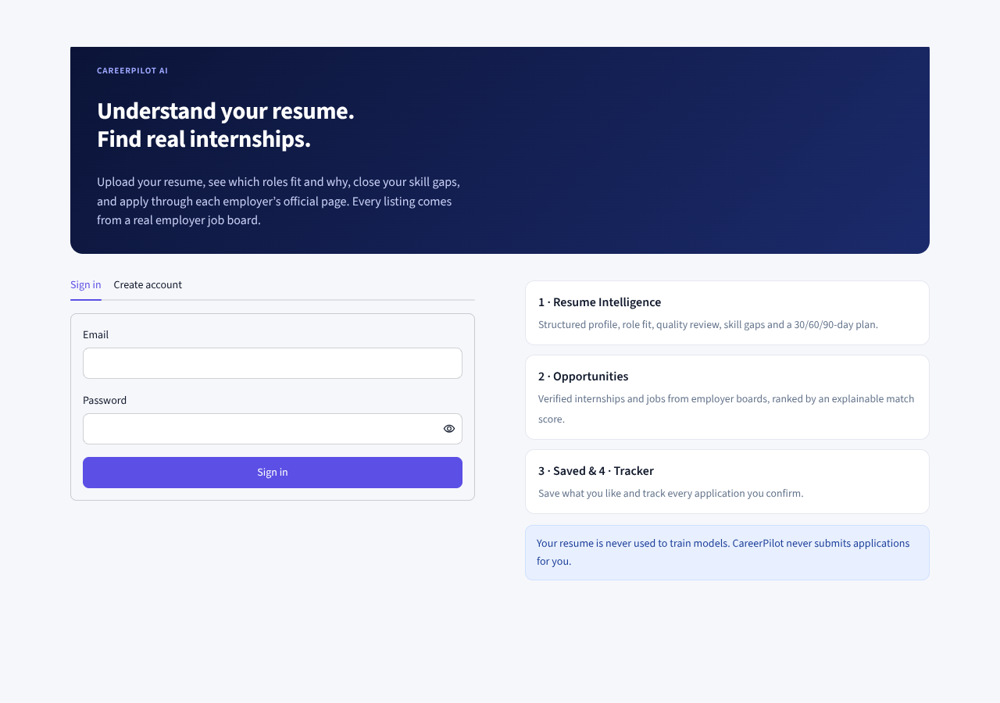
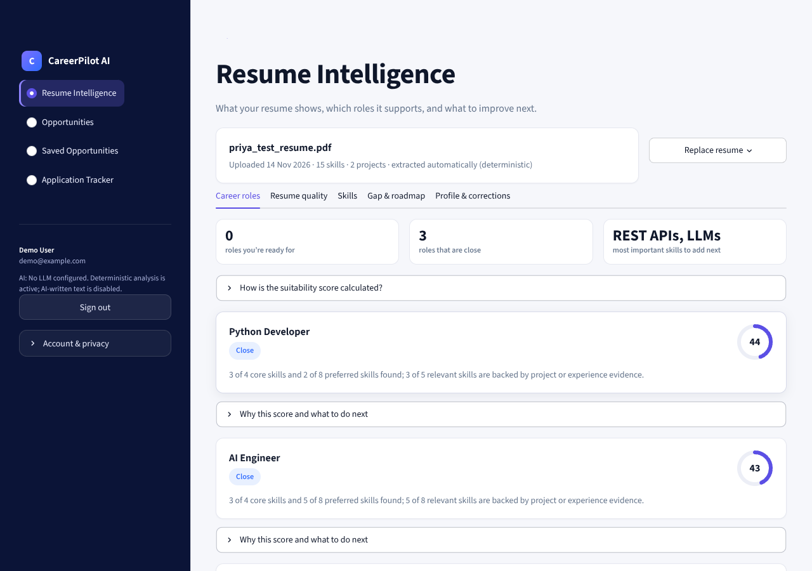
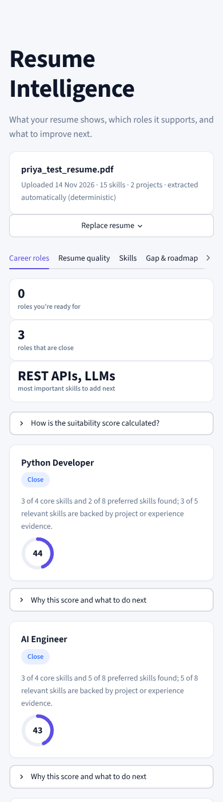

# CareerPilot AI

An AI-powered resume-intelligence and career-opportunity platform for students and early-career candidates.
Upload a resume, see which roles it supports and why, close skill gaps, and find **real, currently published** internships and jobs
from employer job boards, then apply on the employer's official page and track every application.

| Sign in | Resume Intelligence (desktop) | Resume Intelligence (mobile) |
|---|---|---|
|  |  |  |

> Screenshots show the real interface running a **synthetic sample resume** ("Priya Test", a test fixture). Opportunity screenshots are intentionally **not**
> included: the build environment could not reach any employer job board, and the project does not display invented listings. After your first real
> refresh (`python scripts/refresh_opportunities.py`) take your own screenshots of Opportunities, Saved and Tracker.

## Problem
Students send resumes blindly: they do not know which roles their resume actually supports, which claims recruiters will discount, which skills to
learn next, or which of thousands of postings fit. Job sites also mix real vacancies with reposts and dead links.

## The four pages
1. **Resume Intelligence** – PDF/DOCX upload, structured profile with per-skill evidence, role suitability (explained score), resume-quality review
   (what / why / how / example), skill buckets, skill-gap analysis, 30/60/90-day roadmap with progress, readiness summary, profile corrections, retention/deletion.
2. **Opportunities** – internships first, then jobs; filters (role, company, location, work mode, level, skills, posting date, min match); hybrid match score with
   explanation; **Apply on Official Website** (new tab), Save, match explanation (RAG), optional *Tailor resume* and *Cover letter*.
3. **Saved Opportunities** – combined list, type filter, remove, "not interested", match details, official links, listing-status warnings.
4. **Application Tracker** – Interested → Applied → Assessment → Interview → Offer → Rejected; dates, notes, follow-up reminders, filters, status bar.
   An application becomes **Applied only after you confirm** "Did you complete your application?". CareerPilot never submits applications.

## Architecture
```
app.py (Streamlit shell, auth gate, 4-page nav)         ui/  design system (theme.py), components, pages
        │
services/workflow.py  ── orchestrated pipeline with typed hand-offs ────────────────────────────────
  1 ResumeAnalysis  → nlp/ (extract → sections → skills → profile_builder → quality)
  2 CareerRecommendation → ml/roles.py        3 SkillGap → services/analysis.py (+ resources)
  4 OpportunityDiscovery → services/ingestion.py + opportunities/ (http, adapters, normalize)
  5 OpportunityMatching → ml/matching.py      6 ApplicationAssistance → rag/ + LLM providers
        │
repositories/ (every query filtered by user_id)  →  core/models.py (SQLAlchemy 2)  →  SQLite (dev) / PostgreSQL (prod), Alembic migrations
core/llm/ (one provider interface: none | ollama | openai_compatible | anthropic)      core/security.py
rag/store.py (ChromaDB or in-memory numpy; user-scoped metadata filters)               evaluation/ (separate module)
```
**On "agentic":** the workflow is a *deterministic orchestrated pipeline* whose six components exchange validated structures. LLM calls occur only in resume
extraction and application assistance, behind a provider interface with output validation. It is deliberately **not** an autonomous multi-agent system.

### NLP pipeline
PyMuPDF / python-docx extraction (OCR optional via `OCR_ENABLED`, needs `pytesseract` + the tesseract binary) → control/bidi character stripping →
rule-based section detection → taxonomy skill extraction (101 canonical skills with aliases, word-boundary and ambiguity handling) → entity extraction
(contact, links, education, projects, experience, certifications). Each skill keeps up to three **verbatim evidence lines** and is `demonstrated`
(appears in a project/experience/achievement) or `listed` (only in a skills list). With an LLM configured, a Pydantic-validated enrichment is merged **only if
its content is supported by the resume text** (≥80% of key words present); unsupported projects, skills, certifications and achievements are dropped.
Without an LLM everything still works deterministically.

### Role recommendation (explainable heuristic, not a validated model)
`score = 45% core-skill coverage + 15% preferred-skill coverage + 15% evidence strength + 25% text similarity` (weights in `config.py`).
Demonstrated skill = 1.0, listed-only = 0.6, missing = 0. Role requirements in `ml/roles.py` are **curated profiles written for this project**, not scraped data.
A scikit-learn experiment exists (`evaluation/role_classifier.py`) but refuses to run below 200 real labelled examples; none were available, so no trained classifier is shipped.

### Opportunity matching
`score = 40% skills + 30% semantic + 15% role alignment + 15% eligibility`; a hard eligibility mismatch (senior title, ≥3 years beyond yours) caps the score at 35.
*Semantic* = 0.6·cos(resume, posting) + 0.4·cos(best project, posting), calibrated per embedding backend. Eligibility reads years-of-experience, seniority,
PhD, graduation-year and work-authorisation text. If a posting names no recognisable skills the skills weight moves to semantic similarity and the result says so.
Embeddings: **Sentence Transformers** (`all-MiniLM-L6-v2`) when installed (`requirements-ml.txt`); otherwise a clearly labelled lexical `hashing-bow` fallback.

### RAG
Resume chunks (projects, experience, skills, text windows) and posting chunks are embedded; retrieval is filtered by `user_id` + `resume_id`. The LLM must cite
passage ids (`R*` resume, `J*` posting); claims with missing or invalid citations are **dropped** and the groundedness rate is stored. With no LLM, an extractive
explanation is built from the same retrieved passages.

### Database
Users, auth sessions (token hash only), resume profiles, extracted skills, AI analyses (cache), data sources (health), opportunities, matches, saved
opportunities, applications, notifications, rate-limit events. Alembic migration `0001`; a test asserts models and migrations never drift.

## Opportunity sources
Public, keyless, read-only board APIs — endpoints checked against the vendors' public documentation while building:
Greenhouse Job Board API (`boards-api.greenhouse.io/v1/boards/{board}/jobs?content=true`), Lever Postings API (`api.lever.co/v0/postings/{site}?mode=json`, EU host supported),
Ashby job-board API (`api.ashbyhq.com/posting-api/job-board/{board}`). Add companies in `opportunities/company_registry.yaml` (no code change).
**India-first view:** the Opportunities page opens on *India + remote anywhere* (all India, any city; abroad only if remote), with an Indian-city filter (aliases such as Bangalore/Bengaluru, Gurgaon/Gurugram handled) and a **Pay** filter (stipend stated / include "not stated" / everything). Stipend text is shown exactly as the posting or source states it; nothing is estimated, and a listing that does not say is labelled "Stipend not stated". Lists load 20 at a time with **Show more** (Streamlit has no true infinite scroll).
**Adzuna India (optional, licensed API, free key):** set `ADZUNA_APP_ID` / `ADZUNA_APP_KEY` to pull many more India listings. These are labelled *"Via Adzuna · not employer-direct"* and the button says "Apply via Adzuna"; predicted salaries are never shown as stipends; employer-board duplicates win over Adzuna copies.
**Platform links (not scraped):** Internshala, Unstop, LinkedIn, Naukri, foundit, Indeed India, Wellfound and Y Combinator search links for your target role, plus a directory of ~30 company careers pages. LinkedIn, Naukri, Internshala and Unstop are **not scraped** (their terms forbid it and their links cannot be verified as employer-official); you open them yourself.
Safeguards: robots.txt honoured, per-host spacing, retry with backoff and `Retry-After`, no auth/CAPTCHA bypass; apply URLs must be https, non-private, and on an employer
domain or a known ATS host that came from that employer's own board API; duplicates collapse by company+title+location; listings missing from a *successful* fetch become
`unavailable`; stale ones become `unverified`; deadlines are only recorded when the posting states one; a failed source never changes stored data.

## Security & privacy
Argon2 password hashing · session tokens stored only as SHA-256 · login lockout and uniform errors · per-user hourly AI quota · every repository call filtered by
`user_id` · upload validation (extension, magic bytes, size, page count, DOCX zip sanity) · untrusted resume/posting text is sanitised, delimited and the model is told it is data,
with injection patterns flagged · all dynamic text HTML-escaped in the UI · external URL validation · logs never contain resume text · secrets only via environment (`.env` is git-ignored) ·
retention job (`RESUME_RETENTION_DAYS`) and self-service resume/account deletion · resumes are never used for training (`ai_training_consent` defaults to false and nothing reads it for training).

## Setup
```bash
git clone <your repo> && cd CareerPilot_AI
python -m venv .venv && source .venv/bin/activate
pip install -r requirements.txt            # add: pip install -r requirements-ml.txt   for real semantic embeddings
cp .env.example .env
python scripts/verify_sources.py           # which employer boards answer from YOUR machine
python scripts/refresh_opportunities.py    # load real listings
streamlit run app.py
```
**Local Ollama:** `ollama pull llama3.2`, then in `.env`: `LLM_PROVIDER=ollama`, `LLM_MODEL=llama3.2`.
**Hosted LLM:** `LLM_PROVIDER=openai_compatible`, `LLM_BASE_URL`, `LLM_API_KEY`, `LLM_MODEL` (any OpenAI-compatible service), or `LLM_PROVIDER=anthropic` with key + model.
Without a provider the app runs; only AI-written text (profile enrichment, grounded wording, tailored resume, cover letter) is disabled and says why.

## Deployment (Render)
1. Push to GitHub (no `.env`). 2. Render → **New → Blueprint** → select the repo (`render.yaml` creates web service, Postgres, and a 12-hourly refresh cron).
3. In the dashboard set `LLM_BASE_URL`, `LLM_API_KEY`, `LLM_MODEL`, `HTTP_USER_AGENT` (contact email). 4. The start command runs `alembic upgrade head` then Streamlit; health check `/_stcore/health`.
Sentence Transformers needs ≥2 GB RAM: use a larger plan with `requirements-ml.txt`, or accept the lightweight backend (shown in the UI). Docker: `docker build --build-arg ML=1 .`
**This deployment was not performed here**; the blueprint and config are tested statically only.

## Testing
```bash
pip install -r requirements-dev.txt
python -m pytest tests -q          # 121 tests
python evaluation/run_eval.py      # regenerates docs/EVALUATION.md
pip-audit --local                  # dependency vulnerabilities
```
Covered: security primitives, official-URL verification, upload validation, PDF/DOCX extraction (incl. scanned/corrupt), structured-output validation/retry, anti-hallucination merge,
prompt-injection handling, matching behaviour, ingestion (adapters, dedupe, expiry, outage safety, robots), auth/lockout/sessions, **multi-user isolation** (repositories, vector retrieval, workflow),
saved/tracker flows (explicit-confirmation rule), RAG citation validation, quota, migrations vs models, deployment config, secret scanning, headless UI smoke test, evaluation harness.

## Known limitations
- **Windows "Application Control policy has blocked this file":** some Windows setups block compiled files. SQLAlchemy is pinned to 2.0 and run in pure-Python mode so this does not affect it. If the password library (Argon2) is blocked, sign-in automatically uses the built-in scrypt method instead. If another package is blocked, run `python scripts\check_install.py`; using Python 3.12 (the tested version) in a fresh `.venv` also helps.
- **Few listings without Adzuna:** public employer boards carry limited India internships and many do not state stipends. Enable Adzuna and use the platform links for volume.
- **Live job sources were not verified from the build sandbox** (no network route to Greenhouse/Lever/Ashby). Adapters follow the documented schemas and are tested against fixtures shaped like those responses;
  registry board tokens are starting points. Run `scripts/verify_sources.py`; boards that fail are reported and never shown.
- **Sentence Transformers was not run** (model download blocked here). Its code path is implemented; verified behaviour is on the lexical fallback.
- **No real LLM was called.** Provider code is tested with fakes; run with your key and check `evaluation/run_eval.py` for structured-output validity.
- Evaluation numbers come from tiny synthetic fixtures (see `docs/EVALUATION.md`); they are not evidence of real-world accuracy.
- **ChromaDB advisories:** `pip-audit` reports unpatched advisories for all `chromadb` ≤1.5.9 affecting its *server* (HTTP API / RBAC). CareerPilot uses only the embedded client and never starts a Chroma server, but you can avoid the dependency's code path entirely with `VECTOR_BACKEND=memory` (the production default in `render.yaml`).
- Streamlit keeps the login token in session state: a browser refresh signs you out. OCR needs extra system packages. Role requirement profiles are curated, not mined from data.
- Link checking (`PoliteClient.check_url`) exists but is not scheduled; freshness relies on each source's own listing.
